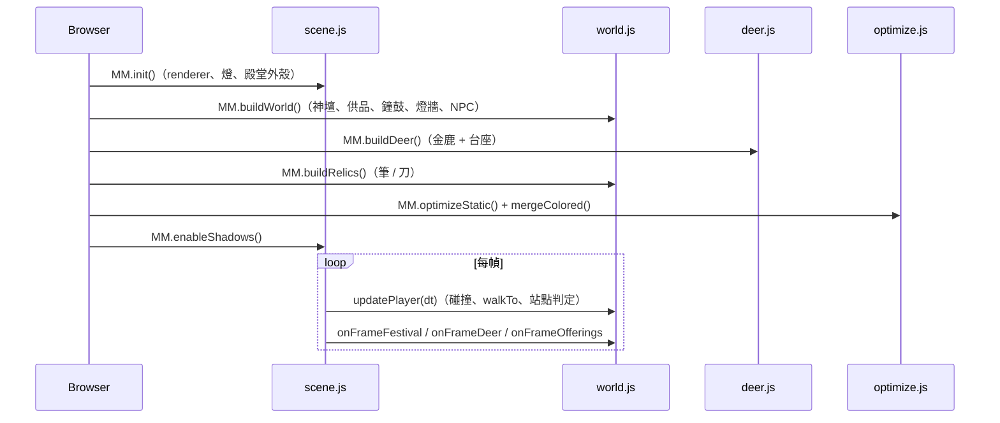
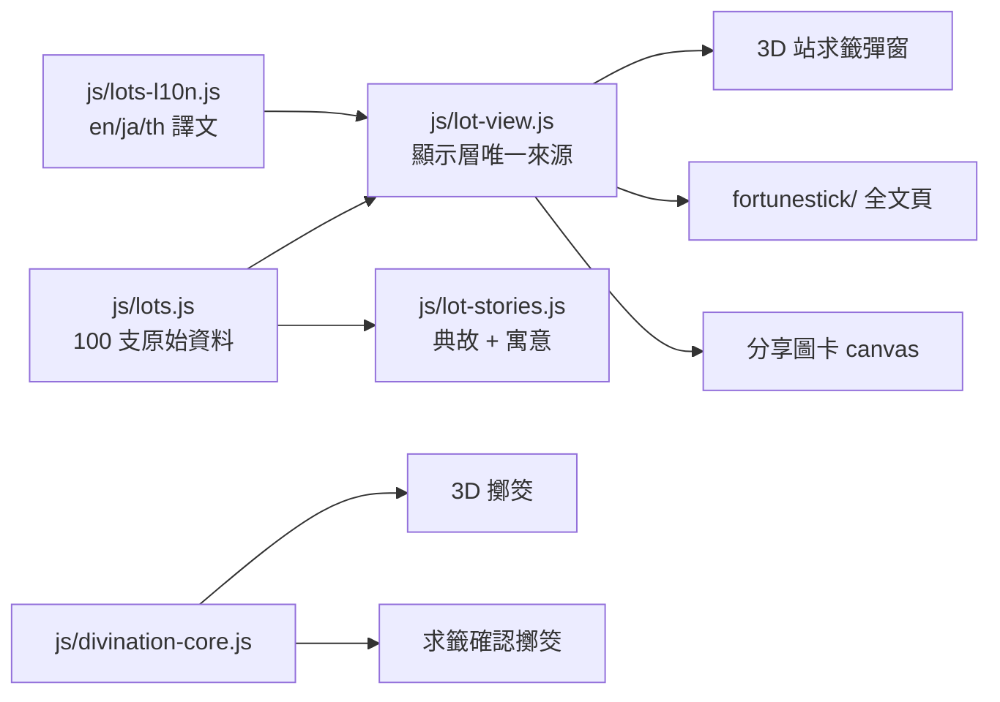
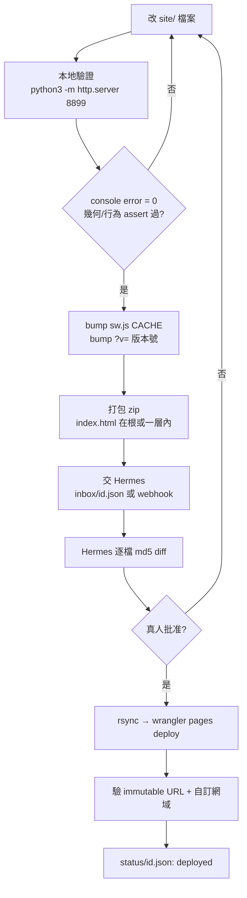

# 文武廟 · 雲端參拜 — 開發手冊（Muse 參考版）

> 對象：接手改動此站的協作編輯者（Muse AI）。
> 原則：**改得到、驗得到、唔會靜靜搞壞其他功能。**
> 最新對應版本：`manmo-v96`（2026-11-10）· 檔案數 139 · 站大小 ~12MB

---

## 1. 一句話架構

純靜態站：`index.html`（HTML + 內嵌 CSS + HUD）＋ vanilla JS 模組 ＋ three.js r128。
**無 build step、無後端、無 npm**。改完直接上傳資料夾就係。

```
瀏覽器
 ├── index.html ── CSS / HUD / 內嵌 script 載入順序
 ├── js/scene.js     renderer / 相機 / 碰撞 / 殿堂外殼 / 貼圖工廠
 ├── js/world.js     神壇 / 供品 / 鐘鼓 / 光明燈 / 求籤動畫 / NPC / 跪拜善信
 ├── js/deer.js      金鹿（幾何、鹿角、麥穗、台座牌面）
 ├── js/relics.js    文昌筆 / 關帝刀
 ├── js/incense.js   上香狀態機（單一真相：爐註冊表 + 步驟表）
 ├── js/optimize.js  靜態幾何合併（draw call 1092 → 323）
 ├── js/festival.js  節慶模式 / 太歲
 ├── js/audio.js     BGM + Web Audio 合成後備
 ├── js/app.js       面板 / 導覽 / 分享圖卡 / PWA
 ├── js/lot-ritual.js  求籤（取香 → 搖籤 → 擲筊）
 ├── js/divination-core.js  擲筊機率核心（唯一來源）
 ├── js/lots.js → 100 支籤原始資料
 ├── js/lots-l10n.js → 三語譯文（中文頁唔載入）
 ├── js/lot-view.js → 籤紙／導讀顯示層（唯一來源）
 ├── js/i18n.js / i18n-3d.js / locales/* → 四語介面
 ├── fortunestick/  100 籤全文頁（zh + en/ja/th 子目錄）
 ├── quick/         五爐快速參拜（免 3D）
 ├── sources/       資料來源與考訂
 └── calendar/      朔望／神誕 .ics
```

---

## 2. 開機與渲染時序



**鐵律**：`optimizeStatic()` 之後，大部分靜態 mesh 已被合併 → 想驗位置**唔可以靠 `Box3`**，要靠 `MM._.stations` 或 group `.position`。
任何要動畫的 subtree 必須標 `userData.dynamic = true`，否則會被合併、動畫失效（v95 鹿角空隙就係咁爆出嚟）。

---

## 3. 三條產品線（同一個資料源）



- 顯示規則**只准寫一份**（`lot-view.js`）。改版式改模組，唔好兩頁各改一次。
- `divination-core.js` 係擲筊機率唯一來源（聖 50% / 笑 25% / 陰 24.9% / 立 0.1%），兩條路徑都必須叫 `DIV.rollJiao()`。
- 求籤流程：**取香 → 搖籤 → 擲筊（聖筊才揭詩）**。未取香搖籤唔應該有反應。

---

## 4. 改動 → 上線 workflow



### 4.1 本地預覽
```bash
cd manmotemple && python3 -m http.server 8899
# 開 http://127.0.0.1:8899/
```

### 4.2 部署（Hermes 執行，Muse 唔需要跑）
```bash
rsync -a --delete site/ ~/hi-we1co/manmotemple/
cd ~/hi-we1co && wrangler pages deploy . --project-name=hi-we1co --branch=main --commit-dirty=true
```
- **一定要 `--branch=main`**（production branch；用 `production` 只會出 preview，自訂網域唔更新）
- 自訂網域更新有 **2–5 分鐘延後**，immutable `*.pages.dev` URL 即時

### 4.3 驗證（缺一不可）
1. immutable URL HTTP 200 + `<title>`
2. `curl --compressed https://<hash>.hi-we1co.pages.dev/manmotemple/sw.js | grep -o 'manmo-vNN'`
3. 自訂網域 `https://hi.we1co.me/manmotemple/` 200（加 `-H 'Cache-Control: no-cache'`）
4. 瀏覽器 console error = 0

---

## 5. 快取紀律（最常出錯的地方）

| 位置 | 規則 |
|---|---|
| `sw.js` 的 `CACHE = "manmo-vNN"` | **任何 JS / CSS / HTML 行為或版面改動都要 bump** |
| `index.html` 的 `?v=` | 改到邊個模組就 bump 邊個（例：`js/world.js?v=20261110b`） |
| `js/app.js` 的 `register("sw.js?v=N")` | 同 CACHE 一齊遞增 |
| `sw.js` 的 `ASSETS` | 新增 JS 模組**一定要加入**，否則離線失效 |

現行：`CACHE = manmo-v96`、`sw.js?v=33`、`scene/world/deer ?v=20261110b`、`lot-ritual ?v=20261113b`、`app.js ?v=20261111y`。

**現行 ASSETS 必須包含 i18n 六件**：`js/i18n.js`、`js/i18n-3d.js`、`js/lots-l10n.js`、`locales/ui.js`、`locales/ui3d.js`、`locales/ritual.js`。
> v96 之前的舊快照曾漏掉這六個 → 外語版離線失效。交件前請保持齊全。

---

## 6. 內容規則（唔可以違反）

| 範圍 | 規則 |
|---|---|
| `.lot-paper` 黃紙（籤詩／聖意／碧仙註／解曰／古人） | **永遠繁體中文**，照廟方籤紙逐字，唔翻譯唔改字（`trText()` 已硬性跳過） |
| 場景貼圖文字（對聯／匾額／紅布／燈籠） | 永遠繁體中文（廟宇實物） |
| 其餘介面文字 | 可譯 en / ja / th，但一定要經 `T(key, 中文default)` |
| 語言判定 | 只靠網址前綴（`/fortunestick/ja/`），**唔准用 `navigator.language` 或 localStorage** |
| 官方性 | 全站標「非廟方官方」；唔可以 tag 東華三院或暗示官方 |
| 求籤資料 | 只用傳統原文（公共領域）；**唔可以抄第三方網站白話解說** |

四語用詞公約（已由用戶拍板，勿自行改）：
`武帝靈簽` 四語保留繁體原名；`聖意` 保留原字；英文唔用 "sacred"；聖筊 = **yes blocks**、笑筊 = laughing blocks、陰筊 = no blocks、立筊 = standing block。

---

## 7. 程式設計約定

1. **唔可以 rename 已上線的 JS 路徑。** 回訪者瀏覽器仍持有舊 `index.html`；`js/lots.js` 改名 → `window.LOTS` undefined → 搖籤無反應（歷史上真實發生過）。改內容唔改檔名。
2. **Sheet 事件用 `body.onclick = handler`**，唔可以用 `addEventListener`（元素重用會疊 listener → 一下 tap 觸發兩次）。
3. **中文直排用逐字 `<i>` 欄（`.vcol`）**，唔可以用 `writing-mode`（Chromium 會疊字）。
4. **橫排右至左標題**用 `flex-direction:row-reverse` + 逐字 `<span>`，`direction:rtl` 無效。
5. **新增 JS 模組要改三個地方**：`index.html` `<script>`、`sw.js` `ASSETS`、`CACHE`／`?v=` bump。
6. **`patch`/字串 replace 前一定 `assert anchor in s`**：靜默 no-op 會留下一半改動，症狀係 boot 時 `X is not defined`。
7. 每次改完跑 `node --check js/*.js`。

---

## 8. 測試方式

```bash
# 語法
for f in js/*.js; do node --check "$f"; done

# 幾何/行為（venv playwright，SwiftShader）
~/.hermes/hermes-agent/venv/bin/python - <<'PY'
from playwright.sync_api import sync_playwright
with sync_playwright() as p:
    b = p.chromium.launch(channel="chromium", args=["--no-sandbox","--use-gl=angle","--use-angle=swiftshader"])
    pg = b.new_page(viewport={"width":390,"height":844}, service_workers="block")
    pg.add_init_script("window.requestAnimationFrame=cb=>setTimeout(()=>cb(performance.now()),16)")
    errs=[]
    pg.on("console", lambda m: errs.append(m.text) if m.type=="error" else None)
    pg.goto("http://127.0.0.1:8899/", wait_until="domcontentloaded")
    pg.wait_for_timeout(6000); pg.click("#enterBtn"); pg.wait_for_timeout(12000)
    print(pg.evaluate("() => ({stations:Object.keys(MM._.stations).length, children:MM._.scene.children.length})"))
    print("errors", len(errs), errs[:3])
    b.close()
PY
```

**量度規則**：
- 驗位置／距離用 `getBoundingClientRect` / `Vector3`，**唔好靠 vision 描述**（同一姿態會有相反判斷）
- 驗 CSS 改動要 `service_workers="block"` 或先 reload，否則量到上一版 CACHE
- headless 下 `requestAnimationFrame` 可能 0 次 → 一定要注入 rAF polyfill，否則所有動畫「假死」
- 量「行距」要取相鄰 `.lp-sec` 的 rect 差，唔可以讀 `getComputedStyle(...).gap`

---

## 9. 資料模型速查

```js
// js/lots.js（100 支，雷雨師一百籤）
{ n, grade, gz, story, poem:[4], shengyi:[], dongpo,
  temple?:{ site, plaque, ancient, poem, shengyi, bixian, jieyue, jieyueP },
  l10n?:{ en|ja|th:{ poem, summary, explanation[2], action, notice, shengyi } } }

// js/lot-stories.js
window.LOT_STORIES[n] = { tale, moral, name? }
```

- `gz` = 十干×十干編號（18 → 乙辛），**唔係年份干支**
- `temple` 有值 = 已對照實物籤紙；`webOnly:true` = 依網頁整理
- `editionNote` 係累加欄位，每次改完 sweep 一次，避免自相矛盾

---

## 10. 交付協議（Muse → Hermes）

Repo：`https://github.com/forumdata-collab/muse-bridge`（詳見其 `README.md`）

```json
// inbox/<id>.json
{ "id": "v97-20261110", "type": "deploy", "project": "manmotemple",
  "zip_url": "https://…/v97.zip", "note": "修鹿角間隙" }
```

- zip：`index.html` 在**根**或**一層內**（`manmotemple/index.html` 可接受）
- 上限 150MB / 4000 檔；唔准 `..` 或絕對路徑
- **唔准放任何 secret**（repo 係 public）
- Hermes 只做下載 + 逐檔 md5 diff → 寫 `status/<id>.json`（`state: diffed`）
- **部署永遠要真人批准**；批准後 Hermes 覆寫 status 為 `deployed` + `deployment_url`

### 交件前自我檢查
- [ ] `node --check` 全過
- [ ] 本地 8899 開得，enter 後 console error = 0
- [ ] 改過 JS/CSS/HTML → `CACHE` + 對應 `?v=` 已 bump
- [ ] 新模組已加入 `sw.js` `ASSETS`
- [ ] `sw.js` 仍包含 i18n 六件
- [ ] 冇刪除我哋 repo 內仍存在的檔案（`.bak-*` 除外）
- [ ] 英文／日文／泰文頁仍正常（至少開一次 `/fortunestick/ja/`）

---

## 11. 已知地雷（血淚清單）

1. **整包覆蓋 = 回歸。** 你手上的快照可能比 live 舊；Hermes 只會 merge 差異檔，缺的檔唔會補回。
2. **`i18n-3d.js` 舊快照**會覆蓋「一百籤 · 第 N 籤」等新翻譯規則。
3. **`sw.js` ASSETS 漏檔**：功能上線但離線失效，線上測試永遠綠。
4. **冇 bump CACHE**：修好都到不了回訪者，用戶會問「確定有改？」。
5. **`world.js` 大幅 splice** 會靜默刪走中間整段函數（曾令 `buildDetails` 消失）。
6. **`setTimeout` 與動畫耦合**：繁忙機上動畫未完成就更新計數 → 「上了香但數字冇加」。
7. **KV 做計數**：最終一致，按三次只加一次。要強一致用 Durable Object。
8. **`optimizeStatic()` 後搵唔到 mesh**：動畫 subtree 必須 `userData.dynamic`。
9. **深鏈 `?lot=NN`** 可繞過搖籤／擲筊直接開籤（測試用；唔係 bug）。
10. **`curl` 唔加 `--compressed`** 會搜壓縮位元組 → 永遠 0 命中，誤判「未更新」。
11. **VM DNS 咬舊 IP**：驗自訂網域要 `curl --resolve`，直接 curl 得 000 係假 fail。
12. **視覺判斷會出錯**：卡數奇數時會「見到」grid 破格；要用幾何量度證明。

---

## 12. 聯絡與權責

- 部署、DNS、Cloudflare、Telegram 通知：Hermes（Oracle VM）
- 3D 場景、模型、材質、文案：Muse（交 zip + diff）
- 產品決策／上線批准：用戶（Telegram）
